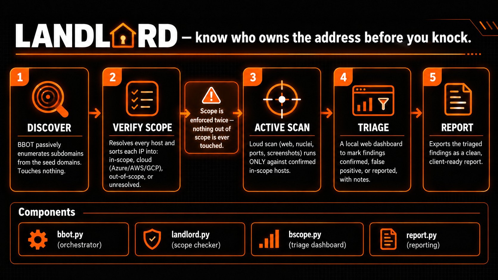

# External Recon Kit



A BBOT-powered toolkit for external penetration testing — from "the client gave
me a few domains" to a triaged, client-ready findings report. It discovers the
full external attack surface, verifies scope against your authorization and the
cloud providers' ranges, runs a scoped active scan, and hands off clean lists to
triage, to other scanners (Nessus, nmap), and to the client.

> **Authorization first.** These tools find and actively test internet-facing
> assets. Only run them against systems you are explicitly authorized to test.
> Discovery is not authorization — anything new goes to the client for sign-off
> before you scan it.

---

## What's in the kit

| Tool | Language | What it does |
| --- | --- | --- |
| `recon.sh` | bash | The orchestrator. Runs the whole pipeline end to end. |
| `landlord.py` | python | Resolves hostnames and classifies each IP as in-scope, cloud (Azure/AWS/GCP), out of scope, or unresolved. Writes a client Excel report. |
| `bscope.py` | python | Local web dashboard for triaging BBOT findings (severity, status, notes), plus an assets view and a screenshot gallery. |
| `report.py` | python | Turns the findings you triaged in `bscope` into a client-ready HTML or Markdown report. |

---

## The pipeline

```
domains ─▶ 1. DISCOVER ─▶ 2. VERIFY SCOPE ─▶ 3. ACTIVE SCAN ─▶ 4. TRIAGE ─▶ 5. REPORT
            (BBOT,          (landlord.py)       (BBOT, scoped)    (bscope.py)   (report.py)
             passive)             │                   ▲
                                  └── in-scope only ──┘
```

1. **Discover** — BBOT enumerates subdomains passively from the seed domains. Touches nothing.
2. **Verify scope** — `landlord.py` resolves everything and sorts each host. Produces the client scope report and the "out of scope, please confirm" list.
3. **Active scan** — BBOT runs a loud scan (web, nuclei, ports, screenshots) **only** against hosts confirmed in scope, plus any in-scope IPs that have no hostname. Scope is enforced twice: by `landlord.py`'s classification and by BBOT's `--strict-scope`.
4. **Triage** — `bscope.py` serves a dashboard to mark findings confirmed / false positive / reported, with notes.
5. **Report** — `report.py` exports the triaged findings as a client report.

---

## Requirements

- **BBOT 3.x** — `pipx install bbot`. Add API keys to `~/.config/bbot/secrets.yml` for far better discovery; `free_secrets.example.yml` lists the free ones (see *API keys* below).
- **Python 3.7+** and, for `landlord.py`:
  ```bash
  pip install -r requirements.txt   # netaddr, requests, openpyxl
  ```
- **jq** — `recon.sh` uses it to parse BBOT output.
- `bscope.py` and `report.py` are standard-library only.

### Install

```bash
git clone https://github.com/TonyDAtigerr/Landlord.git
cd Landlord
pip install -r requirements.txt
chmod +x recon.sh landlord.py bscope.py report.py
```

Keep all the scripts in one folder; `recon.sh` finds the others on your `PATH`
or beside itself.

### Optional: API keys (recommended before your first run)

BBOT works with no keys at all, but discovery quality scales with how many
free API keys it has — the passive phase pulls from every service you give it
a key for. Set these up once, before your first engagement, and every run
benefits.

Add keys under `modules:` in `~/.config/bbot/secrets.yml`. If that file does
not exist, run `bbot --reset-secrets` to generate a fresh one, then edit it:

```yaml
modules:
  virustotal:
    api_key: 'KEY'
  chaos:
    api_key: 'KEY'
  otx:
    api_key: 'KEY'
  github_codesearch:
    api_key: 'KEY'   # the same token also serves github_usersearch and github_org
  # ... securitytrails, censys, leakix, bevigil, fullhunt, builtwith,
  #     hunterio, postman, certspotter, shodan_dns
```

**Free keys worth getting** (each requires a free account):

| Service | Sign up | Notes |
| --- | --- | --- |
| VirusTotal | <https://www.virustotal.com/> | Free public API |
| ProjectDiscovery Chaos | <https://chaos.projectdiscovery.io/> | Free key |
| AlienVault OTX | <https://otx.alienvault.com/> | Free key |
| GitHub | <https://github.com/settings/tokens> | A classic token with **no** permissions checked. One token covers `github_codesearch`, `github_usersearch`, and `github_org`. |
| SecurityTrails | <https://securitytrails.com/> | Free tier |
| Censys | <https://search.censys.io/> | Free tier |
| LeakIX | <https://leakix.net/> | Free key |
| BeVigil | <https://bevigil.com/osint-api> | Free tier |
| FullHunt | <https://fullhunt.io/> | Free tier |
| BuiltWith | <https://api.builtwith.com/> | Free tier |
| Hunter.io | <https://hunter.io/> | Free tier |
| Postman | <https://www.postman.com/> | Free account key |
| Certspotter (SSLMate CT Search API) | <https://sslmate.com/ct_search_api/> | Free tier |
| Shodan | <https://account.shodan.io/> | Free account key. **Bonus:** Shodan occasionally runs a one-time-fee lifetime Membership sale (historically around Black Friday and other holidays) — well worth grabbing if you see it. |

**Currently unavailable** (as of October 2026) — skip these, BBOT will simply
not use the module:

- **BufferOverrun** (`bufferoverrun` module) — the signup page returns
  "Too many API Keys defined for this account. Limit is 10000", which is
  BufferOverrun hitting its own provider's cap. No new keys are being issued.
- **SubdomainRadar** (`subdomainradar` module) — the site shows "This service
  is paused" and is not accepting scans, API requests, or new signups while it
  changes ownership.

> `secrets.yml` holds credentials — `chmod 600` it and keep it out of version
> control. It's in `.gitignore` here already.

---

## Quick start

```bash
# 1. Prepare two files
#    scope_ips.txt : authorized IPs, CIDRs or a-b ranges (one per line)
#    domains.txt   : the client's root domains (one per line)

# 2. Run the whole pipeline
./recon.sh -s scope_ips.txt -d domains.txt -c "Client Name" -a "Your Company"

# 3. Triage in the dashboard it launches (http://127.0.0.1:7373),
#    marking real issues Confirmed / Reported.

# 4. Generate the client report from your triage
python3 report.py recon_YYYYMMDD/03_active/active/output.json \
    --client "Client Name" --assessor "Your Company" -o client_report.html
```

`recon.sh` pauses once, before the active scan, and shows how many hosts it will
touch. Use `--passive-only` to stop after the scope report, or `-y` to skip the
pause.

**Only have a list of IPs?** Run `recon.sh` with the scope file and no `-d`.
It does the seed prep described in
*Starting from IP addresses only* (step 0 of [Finding the client's root domains](#finding-the-clients-root-domains)), then
stops so you can review the domains before running the pipeline:

```bash
./recon.sh -s external_scope.txt          # step 0: IPs -> hostnames -> domains
# review 00_seed_prep/domains.txt, affiliate_root_domains.txt and crtsh_candidates.txt, then:
./recon.sh -s external_scope.txt -d recon_YYYYMMDD/00_seed_prep/domains.txt -o recon_YYYYMMDD
```

---

## Finding the client's root domains

Everything starts from `domains.txt`. These become BBOT's seeds, so accuracy
beats size — a wrong domain pulls unrelated infrastructure into the scan. Work
the sources in this order, best first:

**0. Starting from IP addresses only.** If the client gave you only IPs, have
BBOT find every hostname and IP tied to them:

```bash
bbot -t external_scope.txt -m sslcert shodan_idb viewdns rapiddns hackertarget \
  --brief --event-types DNS_NAME IP_ADDRESS -y | sort -u > hostnames_ips.txt
```

`sslcert` reads the certificates the IPs serve, so it connects to them on TLS
ports. The other modules are passive lookups.

With `--brief`, each line has three tab-separated fields, `TYPE`, `SCOPE` and
`DATA`:

```
DNS_NAME     in-scope    www.example.com
IP_ADDRESS   in-scope    203.0.113.5
DNS_NAME     affiliate   portal.example.net
IP_ADDRESS   affiliate   198.51.100.7
```

- **in-scope**: inside `external_scope.txt`. That's one of your IPs, or a
  hostname that resolves to one. These are your targets.
- **affiliate** (or `distance-N`): related to a target but **outside** scope.
  BBOT found it through an in-scope IP, for example a name on that IP's
  certificate, but it resolves somewhere else: a CDN, cloud host, SaaS, or
  the client's own infrastructure that isn't in your scope. Affiliate
  hostnames are good leads for the domain list. Affiliate IPs must not be
  tested without the client's sign-off.

Split the file by type and scope:

```bash
awk -F'\t' '$1=="DNS_NAME"   && $2=="in-scope" {print $3}' hostnames_ips.txt > inscope_hostnames.txt
awk -F'\t' '$1=="IP_ADDRESS" && $2=="in-scope" {print $3}' hostnames_ips.txt > inscope_ips.txt
awk -F'\t' '$1=="DNS_NAME"   && $2!="in-scope" {print $3}' hostnames_ips.txt > affiliate_hostnames.txt
awk -F'\t' '$1=="IP_ADDRESS" && $2!="in-scope" {print $3}' hostnames_ips.txt > affiliate_ips.txt
```

Reduce the in-scope hostnames to root domains and add them to `domains.txt`.
They're the starting domains for steps 2 and 3 below (azmap and crt.sh):

```bash
sed 's/\.$//; s/^\*\.//' inscope_hostnames.txt | tr 'A-Z' 'a-z' \
  | awk -F. 'NF >= 2 {print $(NF-1) "." $NF}' | sort -u >> domains.txt \
  && sort -u -o domains.txt domains.txt && cat domains.txt
```

Do the same with `affiliate_hostnames.txt`, but review that list first. It
often includes the client's own domains hosted elsewhere, mixed in with CDN
and cloud names.

`./recon.sh -s external_scope.txt` with no `-d` does all of this for you. It
runs the BBOT command and splits the results by scope. It takes the root
domains, keeping names like `client.co.uk` whole, and expands the in-scope ones
through azmap and crt.sh. It writes everything to `00_seed_prep/` and then
stops. Review `domains.txt`, add the keepers from `affiliate_root_domains.txt`
and `crtsh_candidates.txt`, then run the pipeline with `-d` pointing at the
reviewed list. Once you have the in-scope IPs and a complete domains list,
landlord does the rest.

**1. Ask the client at kickoff.** Anything they hand you is authoritative; start there.

**2. Microsoft 365 tenant domains.** For each domain you already know, list the
others registered in the same tenant. This appends every tenant domain to
`domains.txt`, lowercased, sorted and deduplicated:

```bash
curl -s "https://azmap.dev/api/tenant?domain=example.com&extract=true" \
  | jq -r '.related_domains[]?' | tr 'A-Z' 'a-z' >> domains.txt \
  && sort -u -o domains.txt domains.txt && cat domains.txt
```

Already have a few confirmed domains in `domains.txt`? Expand all of them in
one go (the loop reads the file once before it starts appending):

```bash
for d in $(grep -v '^#' domains.txt); do
  curl -s "https://azmap.dev/api/tenant?domain=$d&extract=true" | jq -r '.related_domains[]?'
done | tr 'A-Z' 'a-z' >> domains.txt && sort -u -o domains.txt domains.txt && cat domains.txt
```

**3. Shared certificates.** Root domains that show up on certificates alongside a
known one. Certificates often carry CDN, hosting and certificate-provider names
too, so this one goes through a review file first instead of straight into
`domains.txt`. Step one writes the candidates, most common first:

```bash
curl -s "https://crt.sh/?q=example.com&output=json" | jq -r '.[].name_value' \
  | tr 'A-Z' 'a-z' | sed 's/^\*\.//' | grep -E '^[a-z0-9.-]+$' \
  | awk -F. 'NF >= 2 {print $(NF-1) "." $NF}' \
  | sort | uniq -c | sort -rn | tee crtsh_candidates.txt
```

Delete the lines you don't want from `crtsh_candidates.txt` (CDNs, cert
providers, anything that isn't the client), then step two appends the keepers
to `domains.txt`, deduplicated:

```bash
awk '{print $2}' crtsh_candidates.txt >> domains.txt \
  && sort -u -o domains.txt domains.txt && cat domains.txt
```

> Domains under a two-part public suffix (`client.co.uk`, `client.com.au`) come
> out as the bare suffix (`co.uk`). Add those by hand.

**4. Reverse WHOIS by registrant email.** Every domain registered with the same
address (needs a Whoxy API key in `$WHOXY_KEY`). Whoxy pages its results, so
this walks every page and appends the domains to `domains.txt`, lowercased,
sorted and deduplicated:

```bash
Q="https://api.whoxy.com/?key=$WHOXY_KEY&reverse=whois&email=domains@example.com"
for page in $(seq 1 "$(curl -s "$Q&page=1" | jq -r '.total_pages // 1')"); do
  curl -s "$Q&page=$page" | jq -r '.search_result[]?.domain_name'
done | tr 'A-Z' 'a-z' >> domains.txt && sort -u -o domains.txt domains.txt && cat domains.txt
```

**5. The client's own websites.** Footers, "our brands" pages, and privacy
policies often list sister domains.

**Verify before adding.** For anything that didn't come straight from the client,
look for at least two signs it's really theirs: shared name servers
(`dig +short NS <domain>`), shared mail (`dig +short MX <domain>`), it resolves
into their IP ranges, or it shares a certificate with a known domain. A large
corporate group can own domains that belong to separate businesses with their
own contracts, so when coverage is unclear, confirm with the client first.

Put the confirmed domains in `domains.txt` (one per line) and your authorized IP
ranges in `scope_ips.txt` (IPs, CIDRs, or `a-b` ranges, one per line). Then run
the pipeline as shown above.

---

## `recon.sh` options

Run `./recon.sh -h` for the built-in help. Full flag list:

| Flag | Argument | What it does |
| --- | --- | --- |
| `-s` | FILE | **Required.** Authorized scope: IPs, CIDRs, or `a-b` ranges, one per line. Used as both the landlord scope and BBOT's scope. |
| `-d` | FILE or DOMAIN | Repeatable. Seed domains: a file (one per line) or a literal domain. Mix files and domains freely. Leave it out to run seed prep (step 0: IPs → hostnames → domains via BBOT, azmap and crt.sh), which stops before the pipeline. |
| `-o` | DIR | Output directory (default: `recon_<date>`). |
| `-c` | "Name" | Client name shown on the reports. |
| `-a` | "Name" | Assessor / your company name shown on the reports. |
| `--gcp` | | Also classify Google Cloud ranges in the scope report. |
| `--passive-only` | | Stop after discovery and the scope report. No active scan. |
| `--deep` | | Kitchen-sink active scan (see *Tuning the active scan* below). Loud and intrusive; authorized engagements only. |
| `--active-preset` | "P ..." | Override the active-scan BBOT presets entirely. |
| `--active-modules` | "M ..." | Override the active-scan BBOT modules entirely. |
| `--no-config-tuning` | | Don't apply the quieter/faster active-scan config (WAF avoidance, bounded spider, etc.). |
| `--dns-qps` | N | DNS queries/sec for brute forcing (default: 500). |
| `--no-serve` | | Do everything but don't launch the bscope dashboard; prints the command to launch it yourself. |
| `--bscope-port` | N | Port for the bscope dashboard (default: 7373). |
| `-y` | | Non-interactive: skip the pause before the active scan. |
| `-h` | | Show help. |

---

## Output files

Each run writes to an output folder (`recon_<date>` by default):

**For the client**
- `scope_report.xlsx` — full classification report with charts
- `out_of_scope_for_client.xlsx` — assets outside scope, with columns for the client to confirm ownership / authorize testing
- `out_of_scope_ips.txt` — the bare out-of-scope IPs

**For your scanners**
- `active_targets.txt` — one entry per in-scope host, deduplicated: the hostname if it has one, otherwise the bare IP (no overlap — an IP a hostname already resolves to is not repeated). This is the list the active scan uses, and the list to paste into Nessus / nmap.
- `inscope_ips.txt` — every in-scope IP (with and without a hostname)
- `inscope_hostnames.txt` — confirmed in-scope hostnames
- `inscope_ips_no_hostname.txt` — in-scope IPs no hostname points at (subset of the above)
- `open_ports.txt` — open ports BBOT confirmed, as `host:port`

**Seed prep (`00_seed_prep/`, only when run without `-d`)**
- `hostnames_ips.txt`: raw BBOT output (`TYPE`, `SCOPE`, `DATA`, tab-separated)
- `inscope_hostnames.txt`, `inscope_ips.txt`: hostnames and IPs inside the scope file
- `affiliate_hostnames.txt`: related hostnames outside scope. These are leads, not targets.
- `affiliate_ips.txt`: related IPs outside scope. Don't test them without client sign-off.
- `root_domains.txt`, `azmap_domains.txt`: in-scope root domains, plus M365 tenant domains
- `affiliate_root_domains.txt`: root domains of the affiliate hostnames. Review it before using any of them.
- `crtsh_candidates.txt`: root domains on shared certificates, with counts. Review it before using any of them.
- `domains.txt`: the draft seed list (root + tenant domains). Review it, then pass it with `-d`.

**Raw / intermediate**
- `01_passive/`, `03_active/` — raw BBOT output (NDJSON + CSV)
- `all_hostnames.txt`, `scope_check.json` — intermediate data

---

## Using the tools on their own

Each tool works standalone; `recon.sh` just chains them.

```bash
# Scope-check an existing hostname list
landlord.py hostnames.txt scope.txt --xlsx report.xlsx --client "Client"

# Triage any BBOT output
bscope.py path/to/output.json --shots path/to/screenshots

# Report from a triaged scan
report.py path/to/output.json --client "Client" --format html
```

### report.py statuses

`report.py` reads the triage file `bscope` saves (`<output>.bscope.json`). By
default it includes only **confirmed**, **reviewed**, and **reported** findings,
so "new" noise never reaches the client. Override with `--include
confirmed,reported` or `--all` (everything except *new*).

---

## Under the hood: doing it all by hand

`recon.sh` runs the commands below, in this order. This section shows each one
and a manual way to get the same result without the kit, using BBOT, `jq`,
`dig`, `curl`, [`grepcidr`](https://github.com/jrlevine/grepcidr)
(`apt install grepcidr`) and a few lines of stdlib Python. It's useful for
checking what the tools do, for debugging a run, or for running one stage by
itself.

The examples assume your two input files, `scope_ips.txt` and `domains.txt`,
and that you're working in an output folder:

```bash
OUT=recon_$(date +%Y%m%d); mkdir -p "$OUT"
```

### 0. Prepare the inputs

**Clean the seed list.** `recon.sh` merges every `-d` file and domain into
`seeds.txt`, then strips comments and whitespace, lowercases it and removes
duplicates:

```bash
cat domains.txt | sed 's/#.*//; s/[[:space:]]//g' | tr 'A-Z' 'a-z' \
  | awk 'NF && !seen[$0]++' > "$OUT/seeds.txt"
```

**Expand the scope to single IPs.** Later steps need to know which in-scope
IPs no hostname points at, so every CIDR and `a-b` range is expanded to its
individual host addresses. Entries larger than a /16 (65,536 addresses) are
skipped because you can't list them one host at a time; for those, hostname
discovery is the only way in.

```bash
python3 - scope_ips.txt > "$OUT/scope_all_ips.txt" <<'PY'
import sys, ipaddress
for line in open(sys.argv[1]):
    line = line.split("#", 1)[0].strip()
    if not line: continue
    if "-" in line and "/" not in line:
        a, b = (ipaddress.ip_address(x.strip()) for x in line.split("-", 1))
        nets = list(ipaddress.summarize_address_range(a, b))
    else:
        nets = [ipaddress.ip_network(line, strict=False)]
    if sum(n.num_addresses for n in nets) > 65536: continue
    for n in nets:
        print(*([n.network_address] if n.num_addresses == 1 else n.hosts()), sep="\n")
PY
```

### 1. Passive discovery (BBOT)

This is the same BBOT command `recon.sh` runs. The scope file is the target
(`-t`) and the domains are the seeds (`-s`). `-rf passive` limits BBOT to
passive modules, so it never sends traffic to the client. `-em viewdns` turns
off a noisy reverse-WHOIS module.

```bash
bbot -t scope_ips.txt -s "$OUT/seeds.txt" \
     -p subdomain-enum -rf passive -em viewdns \
     -c dns.brute_threads=500 \
     -n passive -o "$OUT/01_passive" -y
```

BBOT writes `01_passive/passive/output.json` with one JSON event per line.
Pull out every hostname it found, lowercased, without trailing dots or
wildcards, and deduplicated:

```bash
jq -r 'select(.type=="DNS_NAME") | .data' "$OUT/01_passive/passive/output.json" \
  | tr 'A-Z' 'a-z' | sed 's/\.$//; s/^\*\.//' | awk 'NF && !seen[$0]++' | sort \
  > "$OUT/all_hostnames.txt"
```

### 2. Scope verification (what `landlord.py` does)

`landlord.py` does four things: it downloads the cloud providers' published IP
ranges, resolves every hostname, checks each IP against the ranges in a fixed
order, and writes the results to a report.

**2a. Download the cloud ranges.** landlord caches these in
`~/.cache/landlord/` for 7 days (`--refresh` ignores the cache). Each command
below writes `CIDR label` lines, where the label is the provider's
service/region and becomes the "Provider / Service" column in the report.

```bash
# AWS
curl -s https://ip-ranges.amazonaws.com/ip-ranges.json \
  | jq -r '(.prefixes[] | "\(.ip_prefix) \(.service)/\(.region)"),
           (.ipv6_prefixes[] | "\(.ipv6_prefix) \(.service)/\(.region)")' > aws_ranges.txt

# Azure Public. Microsoft has no fixed URL for this file, so take the
# current link from the download page. (For Azure Government use id=57063
# and ServiceTags_AzureGovernment.)
AZ=$(curl -sA 'Mozilla/5.0' 'https://www.microsoft.com/en-us/download/confirmation.aspx?id=56519' \
  | grep -oE 'https://download\.microsoft\.com/download/[^"'\'']+/ServiceTags_Public_[0-9]{8}\.json' | head -1)
curl -s "$AZ" | jq -r '.values[]
  | (if (.properties.systemService // "") == "" then .name else .properties.systemService end) as $s
  | .properties.region as $r | .properties.addressPrefixes[]
  | if ($r // "") == "" then "\(.) \($s)" else "\(.) \($s)/\($r)" end' > azure_ranges.txt

# Google Cloud (only with --gcp)
curl -s https://www.gstatic.com/ipranges/cloud.json \
  | jq -r '.prefixes[] | "\(.ipv4Prefix // .ipv6Prefix) \(.service)/\(.scope)"' > gcp_ranges.txt

# Plain CIDR lists for grepcidr
for p in aws azure gcp; do cut -d' ' -f1 ${p}_ranges.txt > $p.cidrs; done
sed 's/#.*//; s/[[:space:]]//g' scope_ips.txt | awk NF > scope.cidrs
```

> landlord also accepts hostnames in the scope file and resolves them to IPs.
> If yours has any, replace each one in `scope.cidrs` with the output of
> `dig +short A <name>` and `dig +short AAAA <name>`.

**2b. Resolve every hostname.** landlord collects every A and AAAA address
(following CNAMEs) and records hosts that don't resolve. It writes one
`ip hostname` pair per line:

```bash
: > unresolved.txt
while read -r h; do
  ips=$( { dig +short A "$h"; dig +short AAAA "$h"; } | grep -E '^[0-9.]+$|:' | sort -u)
  if [ -z "$ips" ]; then echo "$h" >> unresolved.txt
  else for ip in $ips; do echo "$ip $h"; done; fi
done < "$OUT/all_hostnames.txt" > resolved.txt
```

(landlord runs 20 lookups at once. This loop runs them one at a time, which
is slower but gives the same result.)

**2c. Classify.** Each IP goes into the **first** list that contains it:
scope, then Azure, then AWS, then GCP. That order means anything in your agreed
scope counts as in scope even if it's also in a cloud range. Anything left over
is out of scope:

```bash
cp resolved.txt remaining.txt
for p in scope azure aws gcp; do
  [ -f $p.cidrs ] || continue
  grepcidr    -f $p.cidrs remaining.txt > class_$p.txt
  grepcidr -v -f $p.cidrs remaining.txt > rest.tmp; mv rest.tmp remaining.txt
done
mv remaining.txt class_out.txt
wc -l class_*.txt unresolved.txt
```

To fill in the Provider / Service column for a cloud list, look up which range
each IP falls in:

```bash
python3 - aws_ranges.txt class_aws.txt <<'PY'
import sys, ipaddress
nets = [(ipaddress.ip_network(c, strict=False), l.strip())
        for c, l in (x.split(None, 1) for x in open(sys.argv[1]) if x.strip())]
for line in open(sys.argv[2]):
    ip, host = line.split()
    a = ipaddress.ip_address(ip)
    print(host, ip, next((l for n, l in nets if a in n), "?"), sep="\t")
PY
```

**2d. Build the report.** `scope_report.xlsx` contains these lists formatted as
sheets:

- **Hosts**: hostname, IP, IPv4/IPv6, classification and In Scope verdict. The
  verdict is Yes for scope, No for out, Review (cloud) for any cloud provider,
  and Unresolved.
- **Summary**: a count for each classification, with a pie chart.
- **Cloud Services**: hosts grouped by the provider's service.
- **Methodology**: a legend and the source URLs.

If you're doing it by hand, paste the `class_*.txt` files into a spreadsheet
with a Classification column. landlord also saves the raw data as
`scope_check.json`:
`{"results": [{"host", "ip", "category", "match"}], "unresolved": [...]}`.

### 3. Build the target lists

These lists come from the classification above. They are what the active scan
uses and what you give to other scanners.

```bash
cut -d' ' -f2 class_scope.txt | sort -u > "$OUT/inscope_hostnames.txt"
cut -d' ' -f1 class_scope.txt | sort -u > "$OUT/inscope_ips_with_hostname.txt"

# In-scope IPs that no hostname points at. They still get scanned.
comm -23 <(sort -u "$OUT/scope_all_ips.txt") <(sort -u "$OUT/inscope_ips_with_hostname.txt") \
  > "$OUT/inscope_ips_no_hostname.txt"

# Out of scope. The client should confirm these. Cloud hosts go in the same
# workbook (out_of_scope_for_client.xlsx), which has "Yours?" and "OK to test?" columns.
cut -d' ' -f1 class_out.txt | sort -u > "$OUT/out_of_scope_ips.txt"

# Active targets: one entry per host, using the hostname when there is one,
# otherwise the bare IP. No overlap.
cat "$OUT/inscope_hostnames.txt" "$OUT/inscope_ips_no_hostname.txt" \
  | awk 'NF && !seen[$0]++' > "$OUT/active_targets.txt"

# Every in-scope IP, sorted numerically
cat "$OUT/inscope_ips_with_hostname.txt" "$OUT/inscope_ips_no_hostname.txt" | awk NF \
  | sort -u -t. -k1,1n -k2,2n -k3,3n -k4,4n > "$OUT/inscope_ips.txt"
```

`--passive-only` stops here.

### 4. Active scan (BBOT, scoped)

The confirmed targets are passed as both BBOT's target (`-t`) and its seeds
(`-s`), and `--strict-scope` prevents BBOT from expanding to anything outside
that list. `subdomain-enum` is not run again, because this pass goes deeper on
known hosts rather than looking for new ones. The `-c` options are the
default tuning: no recursive DNS mutations, WAF avoidance during brute force,
a limited spider, and wayback used only to find URLs.

```bash
bbot -t "$OUT/active_targets.txt" -s "$OUT/active_targets.txt" \
     -p web-heavy nuclei web-screenshots \
     -m portscan fingerprintx baddns \
     -c modules.dnsbrute.recursive_mutations=false \
        modules.dnscommonsrv.recursive_mutations=false \
        modules.webbrute.avoid_wafs=true \
        modules.wayback.urls=true modules.wayback.parameters=false modules.wayback.archive=false \
        web.spider_distance=2 web.spider_depth=3 web.spider_links_per_page=10 \
     --strict-scope \
     -n active -o "$OUT/03_active" -y
```

- **`--deep`** replaces the presets with `web-heavy nuclei web-screenshots spider
  webbrute paramminer lightfuzz baddns-heavy cloud-enum code-enum email-enum` and
  the modules with `portscan fingerprintx`.
- **`--no-config-tuning`** leaves out the entire `-c` block.
- **`--active-only`** skips steps 1 to 3. The targets become
  `seeds.txt` + `scope_all_ips.txt`, deduplicated, and `-t` is the scope file
  itself, so `--strict-scope` limits the scan to your authorized ranges:
  `bbot -t scope_ips.txt -s active_targets.txt ...`

After the scan, collect the open ports BBOT confirmed and find the screenshots:

```bash
A="$OUT/03_active/active/output.json"
jq -r 'select(.type=="OPEN_TCP_PORT") | .data' "$A" | sort -u > "$OUT/open_ports.txt"
ls "$OUT/03_active/active/gowitness/screenshots" 2>/dev/null || ls "$OUT/03_active/active/gowitness"
```

### 5. Triage (what `bscope.py` shows you)

bscope reads the same `output.json`. Here's how to get each tab with `jq`:

```bash
# Findings: the VULNERABILITY and FINDING events, sorted so critical comes first
jq -r 'select(.type=="VULNERABILITY" or .type=="FINDING")
  | [(.data.severity // "INFO"), .type, (.data.host // .host // ""), (.data.url // ""),
     (.data.description // "")] | @tsv' "$A" \
  | awk -F'\t' 'BEGIN{r["CRITICAL"]=1;r["HIGH"]=2;r["MEDIUM"]=3;r["LOW"]=4}
                {print (r[toupper($1)]?r[toupper($1)]:5) "\t" $0}' \
  | sort -n | cut -f2- > findings.tsv

# Assets
jq -r 'select(.type=="DNS_NAME") | .data'             "$A" | sort -u > subdomains.txt
jq -r 'select(.type=="OPEN_TCP_PORT") | .data'        "$A" | sort -u > ports.txt
jq -r 'select(.type=="TECHNOLOGY") | "\(.data.host)\t\(.data.technology)"' "$A" | sort -u > tech.tsv
jq -r 'select(.type=="STORAGE_BUCKET") | .data.url'   "$A" | sort -u > buckets.txt

# URLs tab: input for feroxbuster, ffuf, or Burp's target scope
jq -r 'select(.type=="URL" or .type=="URL_UNVERIFIED") | .data' "$A" | sort -u > urls.txt

# Emails tab, plus the user-enumeration commands bscope generates
jq -r 'select(.type=="EMAIL_ADDRESS") | .data' "$A" | tr 'A-Z' 'a-z' | sort -u > emails.txt
for d in $(cut -d@ -f2 emails.txt | sort -u); do
  echo "o365spray --enum -U emails.txt --domain $d --enum-module oauth2"
done
```

For **Screenshots**, open the gowitness folder in an image viewer.

For **Triage**, open `findings.tsv` in a spreadsheet and add Status and Notes
columns. bscope uses these statuses: new, triaging, confirmed, false positive,
not exploitable, reviewed, reported. It saves the same information to
`output.json.bscope.json`.

For the **AttackForge export**, you need nuclei's own JSON. BBOT rewrites
nuclei results as text, so bscope rebuilds the JSON from that text. To get the
original JSON, run nuclei yourself against the same targets:
`nuclei -l "$OUT/active_targets.txt" -jsonl -o nuclei.jsonl`.

### 6. Report (what `report.py` does)

`report.py` uses only the findings you marked **confirmed**, **reviewed** or
**reported**, sorts them by severity and writes HTML or Markdown. To do the
same from your triage spreadsheet, filter on those statuses, sort by severity,
and write each finding up with its host, URL, description and notes. bscope's
generic writeups (Description, Attack Scenario, Remediation) are a good
starting structure for each one.

---

## API keys (strongly recommended)

Discovery quality scales with how many API keys BBOT has, and most of the
services this kit relies on have a **free tier**. The option names BBOT expects
are in [`free_secrets.example.yml`](free_secrets.example.yml); the table below
adds a sign-up link for each:

| Service | Sign up | Notes |
| --- | --- | --- |
| VirusTotal | <https://www.virustotal.com/> | Free public API |
| ProjectDiscovery Chaos | <https://chaos.projectdiscovery.io/> | Free key |
| AlienVault OTX | <https://otx.alienvault.com/> | Free key |
| GitHub | <https://github.com/settings/tokens> | Classic token with **no** scopes; one token covers `github_codesearch`, `github_usersearch`, `github_org` |
| SecurityTrails | <https://securitytrails.com/> | Free tier |
| Censys | <https://search.censys.io/> | Free tier |
| LeakIX | <https://leakix.net/> | Free key |
| BeVigil | <https://bevigil.com/osint-api> | Free tier |
| FullHunt | <https://fullhunt.io/> | Free tier |
| BuiltWith | <https://api.builtwith.com/> | Free tier |
| hunter.io | <https://hunter.io/> | Free tier |
| Postman | <https://www.postman.com/> | Free account key |
| Trickest | <https://trickest.com/> | Free tier |
| Cert Spotter | <https://sslmate.com/ct_search_api/> | SSLMate CT Search API, free tier |
| GitLab | <https://gitlab.com/-/user_settings/personal_access_tokens> | Personal access token (`read_api`) |
| Shodan | <https://account.shodan.io/> | Free account key. Shodan occasionally runs a one-time-fee **lifetime Membership** sale (historically around holidays) — worth grabbing if you see it. |

Fill in your keys and install the file where BBOT reads it:

```bash
cp free_secrets.example.yml ~/.config/bbot/secrets.yml
chmod 600 ~/.config/bbot/secrets.yml
```

The values in the template are fakes and will not work until replaced.

**Have a paid API key?** [`full_secrets.example.yml`](full_secrets.example.yml)
is the same template with **every** secret option BBOT 3.x knows about: the
free keys above, the paid services (Shodan, DeHashed, BufferOverrun, c99,
IPStack, IP2Location, SubDomainRadar, Trajan tokens, ...), the output-module
credentials (Elastic, Neo4j, Splunk, Slack, Teams, ...), and the global
`bbot_io_api_key` / `interactsh_token`. Delete every entry you don't have a
real value for before using it. You can also have BBOT generate its own fully
commented version of that file:

```bash
bbot --reset-secrets   # regenerates ~/.config/bbot/secrets.yml, backs up the old one to .bak
```

Keys can also be passed on the command line for a one-off run:
`bbot -c modules.shodan_dns.api_key=KEY`.

> `secrets.yml` holds credentials. `chmod 600` it and keep it out of version
> control. It's in `.gitignore` here already; only the `*.example.yml` templates are
> committed.

**Currently unavailable** (as of October 2026) — skip these; BBOT will simply
not use the module:

- **BufferOverrun** (`bufferoverrun` module) — the signup page returns
  "Too many API Keys defined for this account. Limit is 10000", its provider
  hitting its own cap. No new keys are being issued.
- **SubdomainRadar** (`subdomainradar` module) — the site shows "This service
  is paused" and is not accepting scans, API requests, or new signups while it
  changes ownership.

---
## Tuning the active scan

The active scan has two built-in profiles, plus full manual control.

**Standard (default).** Solid coverage without the loudest modules:
presets `web-heavy nuclei web-screenshots`, modules `portscan fingerprintx baddns`.

```bash
./recon.sh -s scope_ips.txt -d domains.txt
```

**Deep (`--deep`).** The kitchen-sink profile. On top of the standard presets it
adds cloud-bucket enumeration, code/secret-leak enumeration, email enumeration,
web spidering, directory brute-force (`webbrute`), parameter mining
(`paramminer`), light fuzzing (`lightfuzz`), and all subdomain-takeover checks
(`baddns-heavy`). This is loud and intrusive.

```bash
./recon.sh -s scope_ips.txt -d domains.txt --deep
```

> `--deep`, `lightfuzz`, and `webbrute` are intrusive and can trip a WAF or SOC.
> Only use them when testing at that depth is explicitly authorized.

**Manual override.** Replace the presets and/or modules outright for either
profile with `--active-preset` and `--active-modules`:

```bash
# A lighter, quicker pass than the standard profile
./recon.sh -s scope_ips.txt -d domains.txt \
  --active-preset "web nuclei-budget web-screenshots" --active-modules "portscan"
```

---

## Safety & operating notes

### Cert Spotter is slow with an API key, and that's expected

Near the end of the passive scan you will likely see BBOT sit on one module for
a long time:

```
[INFO] passive: Modules running (incoming:processing:outgoing) certspotter(81:1:0)
[INFO] passive: No events in queue (0 processed in the past 15 seconds)
```

This is not a hang. With an SSLMate key configured, BBOT's `certspotter` module
changes behaviour:

- **Without a key** it makes one request per domain and takes whatever comes
  back in that single page.
- **With a key** it pages through the domain's *entire* certificate history,
  requesting the next page until Cert Spotter returns nothing. SSLMate
  throttles authenticated requests by subscription level; BBOT waits out each
  throttle and carries on.

So the key is working, and it is the reason the module is slow: it is pulling
the client's full certificate history rather than a sample. That is the result
you want from passive discovery.

The queue number (`81` above) is mostly subdomains found by other modules. The
module deduplicates to the highest parent domain, so nearly all of them are
dropped the moment they are picked up. The `1` is a single root domain being
paged through. You are waiting on a handful of lookups, not 81.

Your options, in order of preference:

1. **Let it finish.** Every other module is done by this point, and this is the
   thorough result.
2. **Remove the `certspotter` key** from `~/.config/bbot/secrets.yml`. The module
   drops back to one quick request per domain. Faster, less complete.
3. **Exclude the module** by editing the passive scan line in `recon.sh`
   (`-em viewdns certspotter`). Only sensible if the `crt` module is working,
   since that is BBOT's other certificate-transparency source and it fails
   often because crt.sh times out.

- **Keep the authorization paper trail** (signed scope / email) in the engagement folder.
- **Update nuclei templates** before each engagement: `nuclei -update-templates`.
- **Refresh cloud ranges** for a formal assessment: `landlord.py ... --refresh` (cached ~7 days otherwise).
- **Mind rate limits / WAFs.** The heavy presets are loud and can get your source IP blocked or trip a SOC. Throttle with `--dns-qps` and BBOT's web rate limits if asked.
- **Retention.** Output folders contain the client's full attack surface and findings — treat them as sensitive and dispose of them per your engagement's data-handling terms.

---

## Tested with

- BBOT 3.x
- Python 3.10+

BBOT's CLI changed significantly in 3.0; this kit assumes 3.x (e.g. `--strict-scope`, the `-t`/`-s` target/seed split).

---

## License

Released under the MIT License. See [`LICENSE`](LICENSE).
